# Dexterous Pick-and-Place: Perception → Grasp Synthesis → Dual-Arm Robot

**Model-based dexterous pick-and-place with Allegro hands on a dual-arm UR3/UR3e torso.**
A camera finds the object's 6D pose ([FoundationPose tracker](https://github.com/ismael-esp/foundationpose-ros2-tracker)).
A GPU grasp synthesizer ([BODex](https://github.com/JYChen18/BODex), bilevel-optimized force-closure on
[cuRobo](https://github.com/NVlabs/curobo)) plans a multi-finger grasp plus a collision-free arm trajectory.
The arm then executes it with closed-loop grasp and release barriers. The same synthesis service drives
**Isaac Lab** (both arms) and the **real robot**.

<p align="center">
  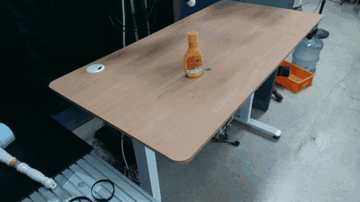
  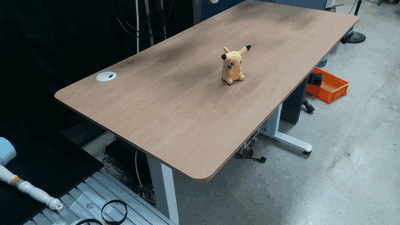
  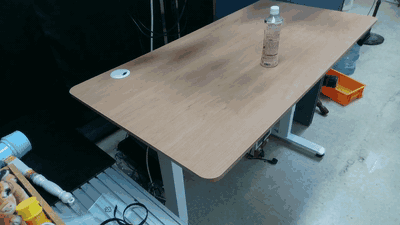
  <br/><sub>Real UR3 + Allegro Hand, objects localized by FoundationPose (4× speed). Left to right: side grasp (mustard),
  top grasp (plush toy), side grasp (tea bottle).</sub>
</p>

**Project page with all videos:** https://ismael-esp.github.io/dexterous-pick-and-place/

| | Result |
|---|---|
| **Real robot**, right arm, 10 objects × 10 trials | **94 / 100 executed trials succeed (94.0 %)**. 3 further attempts were aborted before motion because no grasp met the quality gate (94/103 = 91.3 % counting those). |
| **Isaac Lab**, both arms, 10 objects × 10 episodes each | **180/200 (90%)**: right arm 88/100, left arm 92/100. See [Simulation results](#simulation-isaac-lab-both-arms) |

---

## Contents

- [The system](#the-system)
- [How it works](#how-it-works)
- [Results](#results)
- [Repository layout](#repository-layout)
- [Installation](#installation)
- [Quick start](#quick-start)
- [Simulation (Isaac Lab)](#running-in-simulation)
- [Real hardware](#running-on-the-real-robot)
- [Adding a new object](#adding-a-new-object)
- [Configuration reference](#configuration-reference)
- [Troubleshooting](#troubleshooting)
- [Acknowledgements & licenses](#acknowledgements--licenses)

## The system

| Component | Details |
|---|---|
| Arms | Right **UR3**, left **UR3e**, mounted overhead on a T-shaped torso (`*_overhead.urdf`) |
| Hands | Two **Allegro Hand v4** (16 DoF each), driven over CAN |
| Perception | Intel RealSense D4xx cameras → [FoundationPose tracker](https://github.com/ismael-esp/foundationpose-ros2-tracker) (YOLO-World → SAM 2 → FoundationPose) → `/<object>_pose` |
| Planning | BODex grasp synthesis + cuRobo IK, running as a persistent GPU worker |
| Simulation | Isaac Sim 5.1 / Isaac Lab 2.3, a digital twin of the torso, both arms and both hands |
| Tested scope | **Simulation:** right and left arm. **Hardware:** right arm + right hand (the left arm/hand is present but stays at home). |

The pipeline is **single-arm active, dual-arm aware**. One arm performs the task, and the other arm's
live joint state goes to the planner as collision spheres, so grasps and approach paths avoid it.

## How it works

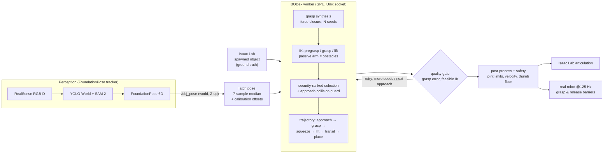

1. **Object pose.** In simulation the object is spawned at a random pose and its ground-truth pose is used.
   On hardware, FoundationPose publishes the pose in the world frame. The runner takes the median of 7
   samples and applies a small per-object calibration offset that compensates the camera→robot bias.
2. **Grasp synthesis (BODex).** Hundreds of hand-pose seeds are optimized in parallel for force closure
   against the object mesh. IK is solved for pregrasp, grasp and lift on the active arm, with the passive
   arm as a collision obstacle.
3. **Selection.** Among IK-feasible grasps, the planner picks the one that engages the most fingers in
   solid contact, with ties broken by lower contact error. An open-hand approach is rejected if it would
   collide with the arm or the table. Top grasps come straight down. Side grasps go up, out, down and in,
   so the approach never sweeps across the object.
4. **Trajectory.** The output is a 22-DoF trajectory (6 arm + 16 hand joints): approach, grasp, squeeze,
   lift, transit, place and release.
5. **Execution.** On hardware the trajectory streams at 125 Hz to `forward_position_controller` with
   closed-loop barriers. The hand only closes once the arm has reached the grasp pose, and it opens at
   the place pose with the arm held still. Safety gates enforce joint limits, a velocity cap and a
   thumb-joint floor.

Each step is described in detail in [docs/PIPELINE.md](docs/PIPELINE.md).

## Results

### Real robot, final benchmark

10 objects, 10 executed trials each, right UR3 + right Allegro, operator-scored, all in one session
(2026-09-03). The operator placed the object at a different spot in the reachable zone for every
trial, and the place target was a fixed goal.
Raw data: [`docs/results/hardware/final_benchmark_right_arm.csv`](docs/results/hardware/final_benchmark_right_arm.csv).
Interactive report: [hardware_final_benchmark.html](https://ismael-esp.github.io/dexterous-pick-and-place/reports/hardware_final_benchmark.html).

| object | grasp | success | no-grasp aborts | mean grasp error | IK-feasible seeds | cycle time [s] |
|---|---|---|---|---|---|---|
| `green_cube` | top | **9/10** | 0 | 0.086 | 263 / 600 | 52.1 |
| `red_cube` | top | **10/10** | 0 | 0.088 | 224 / 600 | 55.1 |
| `pikachu` (plush) | top | **9/10** | 0 | 0.142 | 195 / 600 | 56.4 |
| `whale` (plush) | top | **8/10** | 1 | 0.172 | 193 / 600 | 52.4 |
| `snorlax` (plush) | top | **9/10** | 0 | 0.079 | 230 / 600 | 61.6 |
| `tiger` (plush) | top | **9/10** | 0 | 0.083 | 216 / 600 | 54.0 |
| `milk` carton | top | **10/10** | 0 | 0.079 | 264 / 600 | 50.0 |
| `mustard` bottle | side | **10/10** | 2 | 0.101 | 132 / 600 | 54.4 |
| `green_can` | side | **10/10** | 0 | 0.133 | 66 / 600 | 54.1 |
| `tea_peach` bottle | side | **10/10** | 0 | 0.127 | 208 / 600 | 55.9 |
| **all** | | **94/100 (94.0 %)** | 3 | 0.109 | 199 / 600 | 54.6 |

<p align="center">
  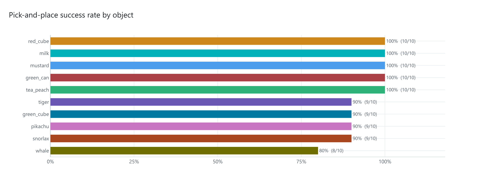
  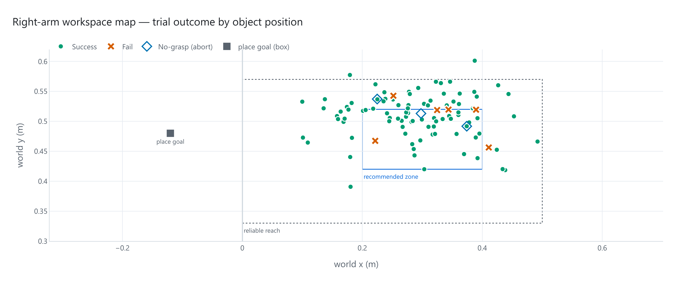
</p>

- A **no-grasp abort** means synthesis found no grasp that passed the quality gate, so the robot didn't
  move. It is reported separately and not counted as an executed trial.
- **Cycle time** covers latching the pose, synthesis, the full motion and the return home. Most of it is
  the deliberately slow, safety-first execution.
- The 6 failed trials were whale ×2, plus green cube, pikachu, snorlax and tiger ×1 each. The workspace
  map shows where every trial started, with the reliable-reach box and the recommended placement zone.

More plots in [`docs/results/hardware/`](docs/results/hardware/): grasp error vs. per-object gate,
IK-feasible seeds, session trend, cycle time.

### Simulation (Isaac Lab, both arms)

Every episode uses the same synthesis service and code path as the real robot, run in Isaac Lab on the full
dual-arm digital twin. The object spawns at a random pose in the active arm's reachable zone and the place target
is randomized too. The idle arm stays in the scene as an obstacle. An episode counts as a success when the object was
lifted (≥ 3 cm) **and** ended within 15 cm (xy) and 8 cm (z, wider for tall objects) of the place target.
Run: 2026-10-15, 10 episodes per object per arm, `--approach auto`, 300 grasp seeds (400 for side-grasp objects).

| object | grasp | right arm (UR3) | left arm (UR3e) |
|---|---|---|---|
| `green_cube` | top | 10/10 | 9/10 |
| `red_cube` | top | 10/10 | 10/10 |
| `pikachu` | top | 10/10 | 9/10 |
| `whale` | top | 10/10 | 10/10 |
| `snorlax` | top | 7/10 | 10/10 |
| `tiger` | top | 8/10 | 9/10 |
| `milk` | top | 10/10 | 10/10 |
| `mustard` | side | 7/10 | 8/10 |
| `green_can` | side | 9/10 | 8/10 |
| `tea_peach` | side | 7/10 | 9/10 |
| **all** | | **88/100 (88%)** | **92/100 (92%)** |

<p align="center">
  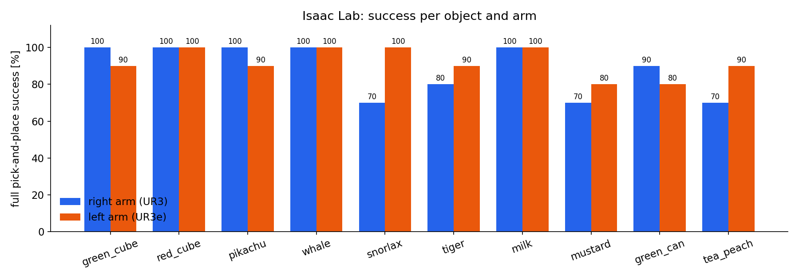
</p>

- **Overall: 180/200 (90%)** across both arms. Grasp (lift) success was 94 %. Of the
  20 failures, 13 were grasps that did not lift the object and 7 were drops or misplacements after lifting.
  29 successful episodes needed the automatic regrasp (the episode re-synthesizes from the object's new pose,
  up to 5 attempts in total).
- With `--approach auto`, a side-grasp object falls back to a top grasp when no side grasp is IK-feasible at that spawn
  pose. On the right arm all 30 side-object episodes used side grasps. On the left arm (mirrored geometry, objects on
  the far side of its reach) 14 of 30 fell back to top grasps, and 12 of those 14 still succeeded.
- Median synthesis time (grasp + full 22-DoF trajectory) was 8.2 s per episode on one RTX 5070 Ti. The left arm's
  upper tail is partly queueing: its last four objects ran as two simulators sharing one synthesis worker.
- The left arm (UR3e) was only tested in simulation. On hardware the right arm was used.
- Per-episode data: [`docs/results/sim/sim_episodes.csv`](docs/results/sim/sim_episodes.csv). Spawn map and timing:
  [`sim_workspace_and_timing.png`](docs/results/sim/sim_workspace_and_timing.png). Reproduce with
  `scripts/run_sim_benchmark.sh` (see [Running in simulation](#running-in-simulation)).

<p align="center">
  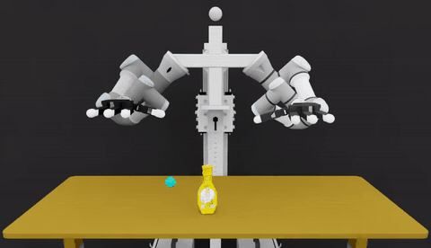
  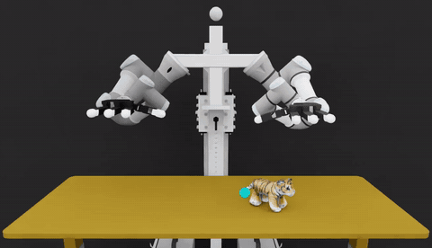
  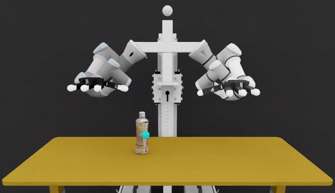
  <br/><sub>Isaac Lab, real time: right-arm side grasp (mustard), left-arm top grasp (tiger), right-arm side grasp (tea bottle).
  All 20 arm × object clips are on the <a href="https://ismael-esp.github.io/dexterous-pick-and-place/#sim">project page</a>.</sub>
</p>

### Real-robot videos (all 10 objects)

| | | | | |
|:-:|:-:|:-:|:-:|:-:|
| 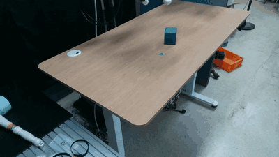 |  | 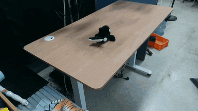 | 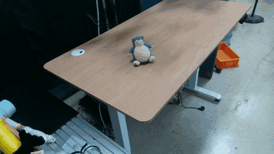 | 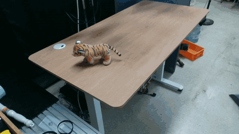 |
| green cube | red cube | whale | snorlax | tiger |
| 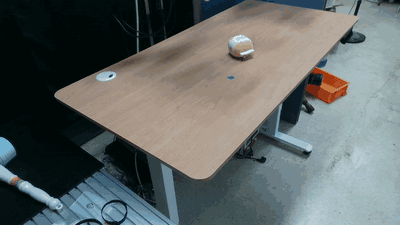 | 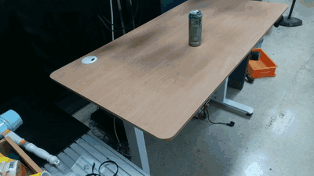 |  |  |  |
| milk | green can | mustard | pikachu | tea bottle |

The full-quality MP4s (3× speed, one per object) and a 2-minute
[10-object highlight reel](docs/media/hardware/hw_highlights_10_objects.mp4) are on the
[project page](https://ismael-esp.github.io/dexterous-pick-and-place/).

## Repository layout

```
bodex_hw/              real-robot runner (ROS 2): benchmark + demo harness, replay with barriers,
                       safety gates, trajectory post-processing, object catalog, place sampler
bodex_service/         persistent BODex GPU worker (server.py) + stdlib-only client (client.py)
isaaclab_tasks/        Isaac Lab DirectRLEnv for the dual-arm torso + the BODex synthesis core
  bodex_pick_place/
    bodex_plan_cli.py  grasp + IK + trajectory synthesis (shared by sim and hardware)
    env.py, env_cfg.py sim scene, object catalog, evaluation
    tshape_cfg.py      torso + UR3/UR3e + Allegro articulations
src/curobo/            cuRobo fork with BODex's grasp solver
  content/configs/manip/sim_{ra_ur3,la_ur3e}_allegro/   task configs for the two arms
  content/configs/robot/{ra_ur3,la_ur3e}_allegro.yml    robot + collision-sphere configs
  content/assets/robot/ur_description/*_overhead.urdf   arm + hand URDFs on the torso
  content/assets/object/custom/                         the 10 benchmark objects (preprocessed)
example_grasp/         BODex batch synthesis/visualization + object preprocessing
scripts/               install, checks, sim benchmark runner + summarizer
docs/                  project page, PIPELINE.md, results (CSVs, plots), videos
```

## Installation

Two Python environments are used. Only the `bodex` env is created by this repo:

| Env | Used by | Contents |
|---|---|---|
| `bodex` (conda, Python 3.10) | grasp-synthesis worker | PyTorch 2.11 + cu128, cuRobo/BODex CUDA kernels, coal 3.0.1, NumPy 1.26.4 |
| Isaac Lab (Python 3.11) | simulation | Isaac Sim 5.1 + Isaac Lab 2.3.0, installed per the [Isaac Lab docs](https://isaac-sim.github.io/IsaacLab/main/source/setup/installation/index.html) |
| system Python 3.10 + ROS 2 Humble | hardware runner | `rclpy`, `sensor_msgs`, `control_msgs`, `numpy` |

```bash
git clone https://github.com/ismael-esp/dexterous-pick-and-place.git
cd dexterous-pick-and-place
bash scripts/install.sh            # creates "bodex", builds both native extensions,
                                   # downloads the Isaac Lab scene assets (~280 MB, release v1.0)
conda activate bodex
python scripts/check_install.py --synth
```
```
  [ OK ] torch + CUDA - torch 2.11.0+cu128, NVIDIA GeForce RTX 5070 Ti
  [ OK ] numpy 1.26 - 1.26.4
  [ OK ] curobo editable install points here - .../dexterous-pick-and-place/src
  [ OK ] cuRobo CUDA kernels - lbfgs_step / kinematics_fused / geom
  [ OK ] coal_openmp_wrapper
  [ OK ] torch_scatter - 2.1.2
  [ OK ] processed object assets - 10 benchmark objects
  [ OK ] Isaac Lab scene assets - isaaclab_tasks/assets
  [ OK ] grasp + trajectory synthesis (worker) - trajectory (148, 22) in 20.8s, grasp_error=0.073
```

The other envs find the worker interpreter through `BODEX_SERVICE_PYTHON`. The install hook sets it
inside `bodex`; export it in the Isaac Lab env and in the ROS shell too:

```bash
export BODEX_SERVICE_PYTHON=$(conda run -n bodex which python)
```

Tested on Ubuntu 22.04, 2× RTX 5070 Ti (Blackwell), driver 570, CUDA 12.8. The exact package set is in
[`scripts/env/bodex_pip_freeze.txt`](scripts/env/bodex_pip_freeze.txt).

## Quick start

Synthesize one pick-and-place from any Python (the client auto-starts the worker in the `bodex` env):

```python
import numpy as np
from bodex_service import BODexClient

with BODexClient() as c:
    r = c.synthesize_pick_and_place(
        active_arm="ra", object_id="red_cube",
        object_pose=np.array([0.25, 0.47, 0.955, 1, 0, 0, 0]),   # x y z qw qx qy qz, world frame
        place_xyz=np.array([-0.12, 0.48, 1.05]),
        approach="top", seed_num=200, table_z=0.92)
print(r["trajectory"].shape, r["grasp_error"])   # (T, 22): 6 arm + 16 hand joints
```

## Running in simulation

```bash
# one object, GUI
$ISAAC_PY isaaclab_tasks/run_bodex_pick_place.py --active_arm la --object_id mustard \
    --approach auto --num_episodes 3 --seed_num 400

# headless with an MP4 of the episode
$ISAAC_PY isaaclab_tasks/run_bodex_pick_place.py --active_arm ra --object_id tiger \
    --num_episodes 1 --seed_num 300 --headless --enable_cameras --video_path runs/tiger.mp4

# the full benchmark (both arms x 10 objects x 10 episodes + one video each), then the tables/plots
ISAAC_PY=$ISAAC_PY bash scripts/run_sim_benchmark.sh
python scripts/summarize_sim_benchmark.py runs/sim_benchmark
```

`ISAAC_PY` is the Python of your Isaac Lab env. Each episode spawns the object at a random pose in the
active arm's reach zone, calls the worker, replays the trajectory with PhysX and scores it. An episode
succeeds when the object is lifted and ends within 15 cm (xy) and 8 cm (z) of the place target.
Pass `--no_record` for headless runs without `--enable_cameras`. On multi-GPU machines, pin the
renderer with `--kit_args="--/renderer/activeGpu=<idx>"`.

## Running on the real robot

**Requirements:** UR arms on `ur_robot_driver` with a `{ra,la}_forward_position_controller`
(JointGroupPositionController). Allegro hands listening on `/joint_states_{right,left}_hand`
(`sensor_msgs/JointState` position targets). Merged `/joint_states`. A TF tree with `world`.
The FoundationPose tracker publishing `/<object>_pose`.

**1. Start perception.** In the FoundationPose repo, run the multi-object switcher, which tracks the
selected benchmark object and publishes `/<object>_pose`:

```bash
python3 test_foundation_pose.py --hand_frame ra_palm_link --viz_local --camera extra --cam_world_source tf
```

**2. Run the benchmark harness** (system Python + ROS 2 Humble). This is the exact command of the final
benchmark:

```bash
source /opt/ros/humble/setup.bash
CUDA_VISIBLE_DEVICES=1 python3 bodex_hw/benchmark_pick_place.py \
    --active_arm ra --warmup --csv benchmark_results/FINAL_TEST.csv
```

| Key | Action |
|---|---|
| number + Enter | select an object (the menu shows its running score) |
| `a` | start one pick-and-place |
| `s` / `f` | score success / fail. This also **stops the motion**, returns home and opens the hand |
| `set <obj> <key> <val>` | live-tune a per-object parameter (e.g. `set whale top_level_min 0.95`) |
| `q` | quit (the CSV is flushed after every row) |

`--warmup` JIT-compiles the CUDA kernels before the first trial. Add `--record` to save both camera
views per trial. `bodex_hw/demo_pick_place.py` is a reviewer-demo variant: pick an object, choose N runs,
and press a key to gate each run. Try the harness without a robot with `--mock`.

**Safety.** The runner checks joint limits, a velocity cap, the Allegro thumb floor (`joint_12 ≥ 0.36`)
and an optional wrist-above-table check before motion. Keep a hand on the e-stop: `s`/`f` aborts mid-motion
with a slow, non-collision-checked return home.

## Adding a new object

1. Scan or model the object and export an OBJ in metres. Use **the same mesh and canonical frame** in
   FoundationPose (`demo_data/<obj>/<obj>.obj`) and here, because the published orientation is applied
   to this mesh. A yaw-mismatched re-scan silently produces wrong grasps.
2. Preprocess it for BODex (watertight mesh, URDF, scene config). Put the raw `<obj>.obj` files in a folder, then:
   ```bash
   C=src/curobo/content/assets/object/custom
   python example_grasp/preprocess_custom_objs.py --input_dir my_objs/ \
       --processed_root $C/processed_data --scene_cfg_root $C/scene_cfg
   ```
3. Register it in **both** catalogs: `isaaclab_tasks/bodex_pick_place/env_cfg.py` `OBJECT_CATALOG`
   (sim, with the USD path) and `bodex_hw/object_meta.py` (hardware). Set the approach (`top` / `side`)
   from its aspect ratio: tall objects (height/width ≥ 1.6) are side-first.
4. Convert the OBJ to USD for Isaac Lab (`isaaclab.sh -p scripts/tools/convert_mesh.py`) and place it
   under `isaaclab_tasks/assets/Materials/<obj>/`.
5. Validate in sim first: `run_bodex_pick_place.py --object_id <obj> --num_episodes 10`.

## Configuration reference

| Where | What |
|---|---|
| `bodex_hw/benchmark_pick_place.py` `BASELINE` / `PER_OBJECT` | hardware defaults and per-object overrides: table height, pose offset, seed count, grasp-error gate, approach, close strength, `top_level_min`, `grasp_z_bonus` |
| `bodex_hw/object_meta.py` / `env_cfg.py` `OBJECT_CATALOG` | object geometry (OBB), scale, approach ranking (keep both in sync) |
| `isaaclab_tasks/bodex_pick_place/bodex_plan_cli.py` | synthesis core: selection, approach guard, side approach path. **Restart the worker after editing.** |
| `src/curobo/content/configs/manip/sim_{ra_ur3,la_ur3e}_allegro/` | BODex optimization (contact links, stages, cost weights) |
| `bodex_hw/pose_correction_cam2.json` | affine camera→world correction (`fit_pose_correction.py` fits it from collected samples) |

## Troubleshooting

| Symptom | Fix |
|---|---|
| `CXXABI_1.3.15 not found` when the worker starts | conda's `libstdc++` must come first: `export LD_LIBRARY_PATH=$CONDA_PREFIX/lib:$LD_LIBRARY_PATH` (the install hook does this) |
| Grasps look fine but the hand goes to an **old** object pose | `curobo` is imported from a different checkout than the worker's code. `check_install.py` verifies this. Re-run `pip install -e .` in the checkout you launch from. |
| `A camera was spawned without the --enable_cameras flag` | headless sim runs need `--no_record` (or `--enable_cameras`) |
| Isaac Sim OOM on a multi-GPU machine | Isaac's renderer defaults to GPU 0. Use `CUDA_VISIBLE_DEVICES=<i> ... --device cuda:0 --kit_args="--/renderer/activeGpu=<i>"` |
| Frequent no-grasp aborts | raise `--seed_num`, keep the object in the recommended zone, check the mesh frame (step 1 above) |
| Allegro ignores external commands after a run | the hand commander in the ROS driver stack must stop re-publishing the last pose when the runner's stream goes silent (a short stale timeout). Otherwise restart the hand driver. |
| `numpy` errors in warp / torch-scatter | `pip install numpy==1.26.4` |

## Acknowledgements & licenses

- **[BODex](https://github.com/JYChen18/BODex)** (Chen et al., ICRA 2025) and **[cuRobo](https://github.com/NVlabs/curobo)**
  (NVIDIA). `src/curobo/` is BODex's cuRobo fork with small changes for this robot. Both are under the
  [NVIDIA License](LICENSE) (non-commercial). This repository is distributed under the same license, and
  third-party assets keep the terms in [LICENSE_ASSETS](LICENSE_ASSETS).
- **[FoundationPose](https://github.com/NVlabs/FoundationPose)**, used through
  [foundationpose-ros2-tracker](https://github.com/ismael-esp/foundationpose-ros2-tracker).
- **[Isaac Lab](https://github.com/isaac-sim/IsaacLab)** / Isaac Sim, Universal Robots ROS 2 driver, Wonik Robotics Allegro Hand.

```bibtex
@inproceedings{chen2025bodex,
  title     = {BODex: Scalable and Efficient Robotic Dexterous Grasp Synthesis Using Bilevel Optimization},
  author    = {Chen, Jiayi and Ke, Yubin and Wang, He},
  booktitle = {ICRA},
  year      = {2025}
}
```
