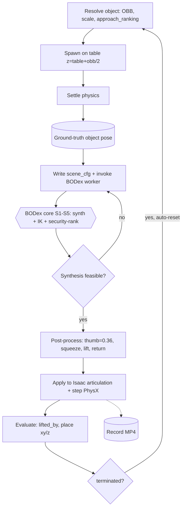
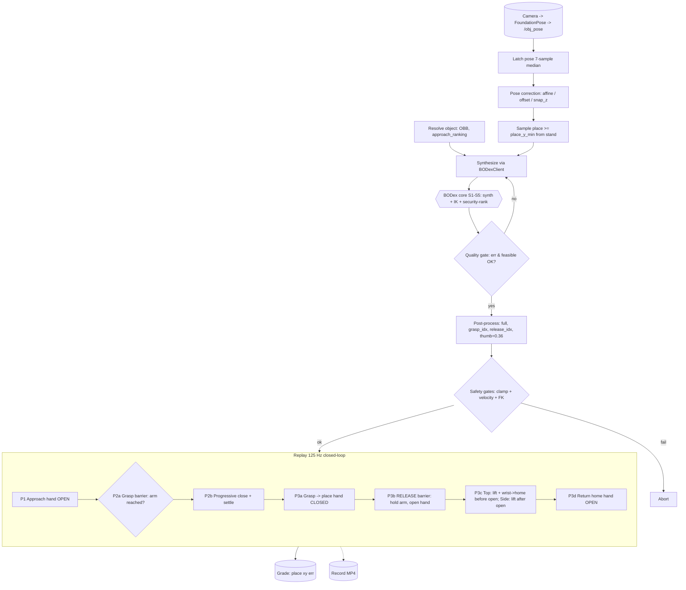

# Pipeline in detail: simulation and hardware

This document describes the two end-to-end BODex dexterous pick-and-place
pipelines: **(A) Simulation** (Isaac Lab) and **(B) Hardware** (real dual UR3/UR3e
+ Allegro). Both pipelines call the **same BODex grasp-synthesis core**; only the
pose source (spawned vs perceived) and the actuation layer (Isaac articulation vs
ROS2 controllers) differ.

---

## 0. Lanes used in the tables below

- **L1 Perception / Object pose** — where the object's 6D pose comes from.
- **L2 Catalog & geometry** — object metadata (OBB, scale, approach ranking).
- **L3 BODex synthesis core** *(shared)* — grasp + IK + trajectory generation (GPU, `bodex` env, behind a Unix socket).
- **L4 Post-process & safety** — trajectory shaping + limit/velocity gates.
- **L5 Actuation** — applying motion (Isaac articulation in sim; ROS2 controllers on hardware).
- **L6 Evaluation / recording** — success grading + video.

---

## 1. Shared core — BODex grasp synthesis (L3, identical in both pipelines)

Both pipelines send `(object_id, object_pose, place_xyz, approach, active_arm,
seed_num, table_z, obb_z_world, passive_arm_state)` to a long-running **BODex
worker** (`bodex_service/server.py`, `bodex` conda env, GPU) over a Unix socket
(`/tmp/bodex_service.sock`). The worker runs `bodex_plan_cli.synthesize_full_trajectory`:

- **S1. Load configs** — manip YAML + overhead robot URDF (`*_overhead.urdf`,
  `base_link=world`, `ee_link=*_palm_link`, 4 fingertip contact links). The URDF
  encodes the T-shape overhead mount (`world→base`) and joint limits (incl. thumb
  `joint_12_0 ≥ 0.36`).
- **S2. Seed + grasp synthesis** — generate `seed_num` grasp seeds; force-closure
  optimization (L-BFGS / particle) produces contact points, forces, per-contact error.
- **S3. IK (3 stages)** — pregrasp, grasp, lift IK on the active arm, with the
  **passive arm injected as collision spheres**; for side grasps a thumb-up filter.
- **S4. Security-ranked seed selection** *(decision)* — among IK-feasible seeds,
  pick the one engaging the MOST fingers in solid force closure (per-contact error
  < `GRASP_ENGAGE_THRESH=0.15`), tiebroken by lower mean error. (NOT the lowest
  optimizer residual — that favored thin pinches.)
- **S5. Build trajectory** — approach (30 wp) → grasp contact → squeeze → lift,
  plus place transit → descend. Returns a raw `[T, 22]` trajectory (6 arm + 16
  hand joints) + metrics (`grasp_error`, `feasible_count/total`).

→ Output: **raw trajectory + quality metrics**, returned over the socket.

---

## 2. Pipeline A — SIMULATION (Isaac Lab)

Entry: `isaaclab_tasks/run_bodex_pick_place.py` → `BODexPickPlaceEnv` (a
`DirectRLEnv`). Two-process: **Isaac Sim** (rendering + PhysX, GPU 0) ⇄ **BODex
worker** (GPU 1) over the socket. Per-episode flow:

| # | Lane | Node | In → Out |
|---|---|---|---|
| A1 | L2 | **Resolve object** (`env_cfg.resolve_object_entry`) | object_id → OBB, scale, mass, spawn_quat, `obb_z_world`, **approach_ranking** (security/side-first) |
| A2 | L5 | **Spawn object on table** (Isaac) | pose = (x,y in spawn zone, z = `table_top_z + obb_z/2`), spawn_quat |
| A3 | L5 | **Settle physics** | object rests; settled pose read back |
| A4 | L1 | **Get object pose** (ground truth from sim) | settled object world pose |
| A5 | L3 | **Write runtime scene_cfg + invoke BODex** (`_invoke_bodex`) | scene_cfg `runtime/latest.npy` → socket → **[Shared core S1–S5]** → raw `[T,22]` |
| A6 | — | **Synthesis feasible?** *(decision)* | no → **cycle approach** in `approach_ranking` (loop to A5) / fail episode; yes → A7 |
| A7 | L4 | **Post-process trajectory** (`_build_and_load_trajectory`) | approach-open (**thumb=0.36**), squeeze override, pre-transit smooth lift, slow-release, return-to-home, preamble → `full [T,22]` |
| A8 | L5 | **Apply to Isaac articulation + step** | stream `full` to the arm (6) + Allegro (16) joint targets; PhysX advances |
| A9 | L6 | **Evaluate** | lifted_by, place xy/z error → grasp_success / place_success / OVERALL |
| A10 | L6 | **Auto-reset** *(loop)* | on `terminated`: reset env (cycle approach on synth fail; `_try_replan` on grasp miss) → back to A1 |
| A11 | L6 | **Record** (optional) | per-step camera frames → MP4 |

**Mermaid (Simulation):**

---

## 3. Pipeline B — HARDWARE (real dual-arm)

Entry: `bodex_hw/run_bodex_pick_place_hw.py` (ROS2 **humble**, system python3 +
rclpy). Perception runs separately (**FoundationPose**, `foundationpose_ros` env)
publishing `/<obj>_pose`. The runner auto-spawns the **same BODex worker**. Flow:

| # | Lane | Node | In → Out |
|---|---|---|---|
| B0 | L1 | **Camera → FoundationPose** (separate node) | RGB-D (cam2) → `/<obj>_pose` (PoseStamped, **world frame, Z-up**, object centroid) |
| B1 | L2 | **Resolve object** (`object_meta.resolve_object_entry`, mirrors env_cfg) | object_id → OBB, `obb_z_world`, approach_ranking |
| B2 | L1 | **Latch object pose** (`ros_io`, 7-sample median) | `/<obj>_pose` → latched world pose |
| B3 | L1 | **Pose corrections** (`_apply_pose_corrections`) | **affine `--pose_correction`** (A·P+b) → **`--obj_xyz_offset`** → **`--snap_z_to_table`** → corrected pose. *(Compensates the camera→world bias; robot+BODex are exact.)* |
| B4 | L2 | **Sample place target** (`place_sampler`) | reachable drop, kept **≥ `--place_y_min`** from the T-shape stand |
| B5 | L3 | **Synthesize** (`BODexClient` → socket) | → **[Shared core S1–S5]** → raw `[T,22]` + metrics |
| B6 | — | **Quality gate** *(decision)* | `grasp_err ≤ --grasp_err_max` AND `feasible ≥ --min_feasible`? no → **cycle approach + raise seeds** (loop to B5) / abort; yes → B7 |
| B7 | L4 | **Post-process** (`trajectory.build_full_trajectory`, numpy port of sim's) | → `full [T,22]`, `grasp_idx`, **`release_idx`** (place pose); open-pose **thumb=0.36** |
| B8 | L4 | **Safety gates** (`safety.py`) | clamp (joint limits + **thumb floor 0.36**) → velocity gate → optional FK wrist-below-table. Fail → abort |
| B9 | L5 | **Replay — closed-loop, 125 Hz** (`ros_io._replay_forward_position`) | streams to `{arm}_forward_position_controller` (Float64MultiArray) + Allegro hand (`/joint_states_{right,left}_hand`) — see phases below |
| B10 | L6 | **Grade** (optional, skip `--no_grade`) | re-latch `/<obj>_pose` post-place → place xy error → SUCCESS/MISS |
| B11 | L6 | **Record** (optional) | camera topics → MP4 |

**B9 replay sub-phases (closed-loop barriers — the key hardware behavior):**
- **P1 Approach** — stream to the grasp pose, hand OPEN throughout.
- **P2a GRASP BARRIER** *(decision)* — wait until measured arm within `--grasp_pos_tol` (or `--grasp_reach_timeout`).
- **P2a.5 Open-hand dwell** — park fingers at the open equilibrium (thumb 0.36).
- **P2b PROGRESSIVE CLOSE + settle** — ramp the hand shut over `--grasp_close_ramp_s` (not a slam), then hold the firm close for `--grasp_settle_s`.
- **P3a Grasp → place** — lift → transit → descend, hand CLOSED (carrying the object).
- **P3b RELEASE BARRIER** — **hold the arm still at the place**, open the hand over `--release_open_s` (clean drop, no drag).
- **P3c Post-release reposition** — never replays BODex's downward set-down. **Top grasps:** lift + rotate the wrist to home/horizontal BEFORE the hand opens, so the down-pointing fingers open sideways clear of the table. **Side grasps:** open at the place, then lift. (`--release_lift_frac`)
- **P3d Return home** — arm to home, hand forced OPEN.

**Mermaid (Hardware):**

---

## 4. Sim vs Hardware — what's shared vs different

| Stage | Simulation | Hardware | Shared? |
|---|---|---|---|
| Object pose source | Spawned + settled (ground truth) | Camera → FoundationPose → `/<obj>_pose` | ✗ |
| Pose correction | none (exact) | affine / offset / snap_z (camera bias) | ✗ |
| Catalog/geometry | `env_cfg.py` | `object_meta.py` (mirror) | ≈ (kept in sync) |
| **Grasp synthesis (S1–S5)** | BODex worker | **same** BODex worker | ✅ identical |
| Trajectory post-process | `env.py::_build_and_load_trajectory` | `trajectory.py` (numpy port) | ≈ (same logic) |
| Thumb floor `joint_12 ≥ 0.36` | open pose | open pose + safety clamp | ✅ |
| Safety gates | (PhysX limits) | clamp + velocity + FK | ✗ |
| Actuation | Isaac articulation targets | ROS2 `forward_position_controller` + Allegro driver | ✗ |
| Grasp/release barriers | implicit (sim converges per-waypoint) | **explicit closed-loop barriers** | ✗ |
| Evaluation | sim state (lifted_by, xy/z) | re-latch `/<obj>_pose` | ≈ |

**One-line summary:** *Both pipelines feed an object pose + geometry into one shared
BODex synthesis core, then shape and execute the resulting trajectory — sim applies
it directly to a perfect digital twin, while hardware first corrects a camera→world
pose bias and then executes with closed-loop grasp/release barriers and safety
gates against a real robot.*

---

## 5. Later additions (2026-06 to 2026-09)

These post-date the §2/§3 lanes above and are now part of the shared **BODex core (L3)**
(`isaaclab_tasks/bodex_pick_place/bodex_plan_cli.py` — restart the worker after editing):

- **Side approach = UP·OUT·DOWN·IN** (all side grasps): high via-point OVER the object → descend at an
  OUTSIDE point → horizontal IN → grasp. Never crosses the object or the table. Top grasps come straight
  down. Replaced the old `face_z`-gated "over-the-top" route that coin-flipped with BODex non-determinism.
- **Open-hand approach collision guard**: FK the OPEN approach hand vs the arm (self-collision) + table
  via a cached cuRobo `RobotWorld`; reject a grasp whose approach would collide and take the next-best
  (grasp quality preserved). `BODEX_DEBUG_APPROACH_Z=1` logs the palm-z profile + guard decisions.
- **`grasp_z_bonus`** (opt-in, default 0): bias side selection toward a HIGHER grasp so fingers clear the
  table on short/uniform cylinders (`green_can`, `tea_peach`). NOT mustard (drives it onto the neck).
- **Release/leave**: open at the HOVER (`release_settle_frac=0`) and lift back to the hover before homing
  so the arm never dips to the table on the way out; `side_approach_curl` lifts the open fingers during
  the side approach for short objects. Best-of-N synth + per-request worker seeding (reproducible poses).
- **New objects**: `green_can`, `tea_peach` (registered in both `object_meta.py` and `env_cfg.py`;
  assets under `content/assets/object/custom/`).
